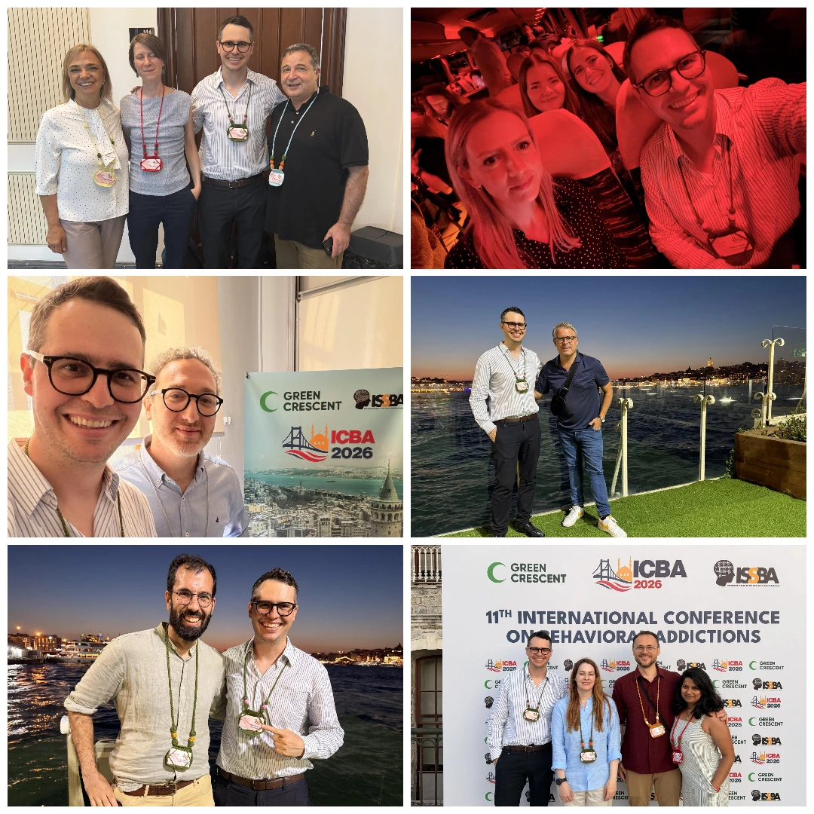

---
authors:
- admin
#- author2

categories:
- Research
- Talks

#- Category 1
date: "2026-08-27T00:00:00Z"
draft: false
featured: false
image:
  #caption: 'Image credit: [**Unsplash**](https://unsplash.com/photos/a-remote-control-sitting-on-top-of-a-wooden-table-lnNlBVMt9vc)'
  focal_point: ""
  placement: 2
  preview_only: true
lastmod: "2026-08-27T00:00:00Z"
projects: []
#subtitle: ""
summary: "11th International Conference on Behavioral Addictions in Istanbul, Turkey"
tags:
- Research
- Conference
- Gambling
- ICBA

title: 11th International Conference on Behavioral Addictions (Istanbul, Turkey)
---

Just got back from the **11th International Conference on Behavioral Addictions (Istanbul, Turkey)**.

As always, I had a very productive and rewarding time working at the conference.

It was fantastic to present my recent research on gambling disorder assessment and to make the case for moving the current gambling disorder assessment landscape further as it needs a major overhaul.

I am very grateful to all colleagues, new and old. It was a pleasure to connect with you all in-person again. Lots of new collaborations to come and some exciting ideas for new research!

See you soon!

# {style="text-align: justify;"}

Stay tuned and follow me on **[Mastodon](https://metalhead.club/@DrHalleyPontes)** and **[X](https://x.com/DrHalleyPontes)** for real-time updates on what's happening next!